<p align="center">
  
</p>

<h1 align="center">OWL</h1>

<p align="center"><strong>The local-first AI coding agent that shows its work.</strong><br>
Plans before it acts, asks before it writes, and proves the result by running your project's own checks.</p>

<p align="center">
  <a href="https://github.com/oyinlola-tech/owl-agent/actions/workflows/quality-checks.yml"></a>
  <a href="https://github.com/oyinlola-tech/owl-agent/actions/workflows/security-scans.yml"></a>
  <a href="https://github.com/oyinlola-tech/owl-agent/actions/workflows/desktop-release.yml"></a>
  <a href="https://github.com/oyinlola-tech/owl-agent/releases"></a>
  <br>
  
  
  
  
  <a href="LICENSE"></a>
</p>

<p align="center">
  <picture>
    <source media="(prefers-color-scheme: dark)" srcset="docs/assets/screenshots/workflow/workspaceApproval.dark.png">
    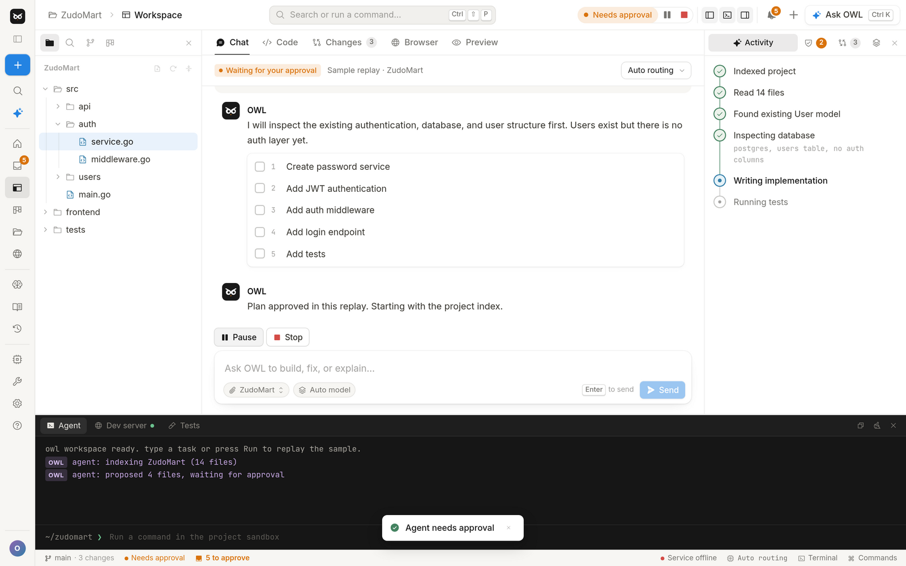
  </picture>
</p>

## Contents

[What OWL is](#what-owl-is) · [Features](#key-features) · [How it works](#how-it-works) · [Screenshots](#screenshots) · [Install](#installation) · [Usage](#usage) · [Configuration](#configuration) · [Data model](#data-model) · [Project structure](#project-structure) · [Development](#development) · [Security](#security) · [Roadmap](#roadmap) · [Contributing](#contributing) · [Author](#author) · [License](#license)

## What OWL is

OWL is a desktop AI coding agent that runs on your machine. It reads the repository you already have, writes a plan, and turns every edit into a diff you can read. Nothing is written, run, or pushed until you approve that exact action, and every applied change lands in a journal you can revert file by file. When the model says it is finished, OWL does not take its word for it: it detects the project's own checks (typecheck, tests, build), runs them itself, and only then marks the task `verified_completed`. The app is a React + TypeScript UI in a Tauri 2 shell; the agent is a Python FastAPI service bundled as a sidecar that listens only on `127.0.0.1` and keeps its state in SQLite. Models come from OpenAI-compatible providers (NVIDIA Build today, with a deterministic mock when no key is set).

## Key features

| | Feature | What it does |
| --- | --- | --- |
|  | Bound approvals | Every write, command, and git action needs an approval tied to a SHA-256 of the tool and its arguments. Single use, expiring, enforced by the service, not the UI. |
|  | Independent verification | OWL runs the project's checks itself after the last change. Model claims such as "tests pass" are recorded but never change the outcome. |
|  | Diffs, not surprises | Edits are proposed, shown as diffs with conflict detection, and applied only after approval. Accept or reject per file. |
|  | Checkpoints and change journal | Each applied change records before/after text; revert any file later. Checkpoints mark every step so tasks can be paused and resumed safely. |
|  | Memory | Durable facts in four scopes (global, project, task, knowledge). Visible, editable, can be disabled; anything that looks like a secret is refused. |
|  | Model routing | Each request is classified (chat, plan, code, debug, big context, summarize, multimodal) and routed to a capable model, with the reason shown. Pin a model at any time. |
|  | Browser capture | Isolated Chromium with SSRF guards captures pages as reference; Browser Studio previews local builds at several widths. |
|  | Local-first | One desktop app per OS. The service binds to loopback, data stays in your app-data folder, and the provider key is never logged or returned. |
|  | Installers and deep links | Windows, macOS, and Linux installers from GitHub Releases, checksum-verifying one-line installers, and `owl://` links that open a screen in the app. |

## How it works

### Architecture

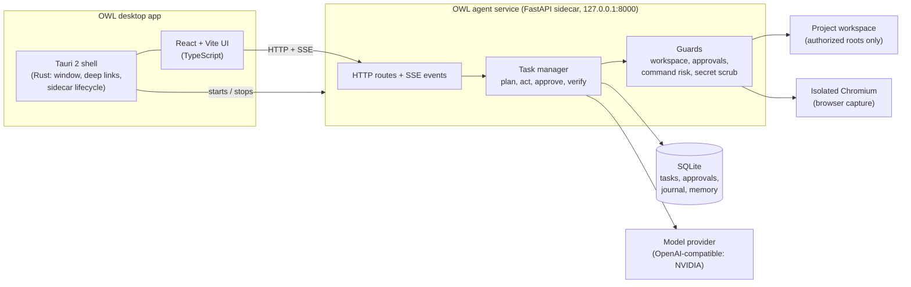

The Tauri shell starts the bundled service when the app opens and stops it when you quit. If port 8000 already has an OWL service (for example one you started from source), the app uses it; if the service is offline the UI keeps working on sample data and says so.

### Task lifecycle

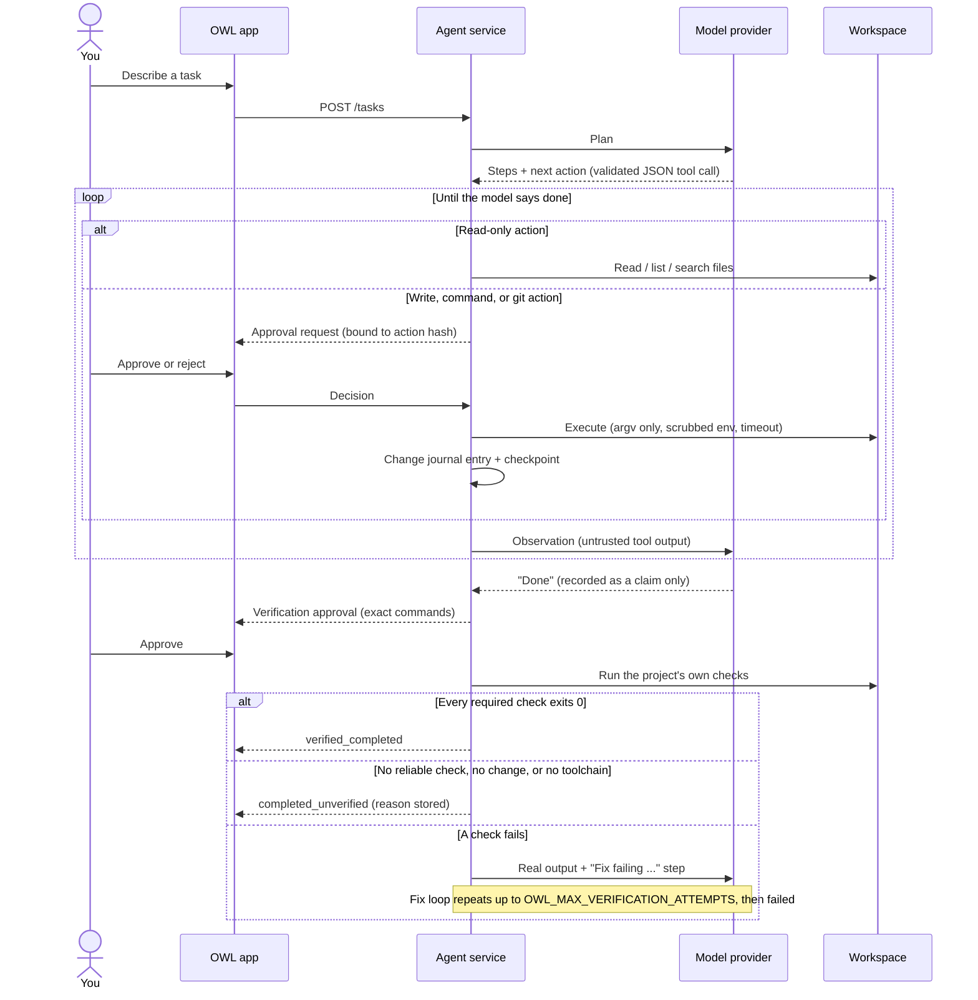

### Verification in plain language

A model can say the work is done; only OWL can prove it. When the model finishes, OWL reads the project's files (never executing anything to do so) to find its real checks: `package.json` scripts for Node (pm picked from the lockfile), `pytest`/`mypy`/`ruff` for Python, `go test` for Go, `cargo test` for Rust, `make test` as a last resort. It asks you to approve that exact list of commands, runs them through the same guarded executor as every other command, and records each run in `verification_runs`.

- **`verified_completed`**: OWL itself ran every required check after the last change and each one exited 0.
- **`completed_unverified`**: finished, but nothing proved it (no change made, no reliable check found, toolchain missing, or no workspace authorized). The reason is stored in `verification_note`.
- **Failure**: the real output goes back to the model as untrusted input, a fix step is added, and OWL verifies again. After `OWL_MAX_VERIFICATION_ATTEMPTS` failed rounds (default 3) the task is `failed`; resuming resets the budget.

Model claims are never trusted because the model cannot see the truth any better than its last tool call, and a test it ran itself could have been the wrong command, an old result, or a hallucinated one. A result only counts if it is the same command and directory as the detected requirement and started after anything that could have changed the workspace. If the task changed a file that decides what a check does (for example the `scripts` in `package.json`), the check is marked tainted and the approval card says so. Commands the model suggests are never added to the check list.

### Task statuses

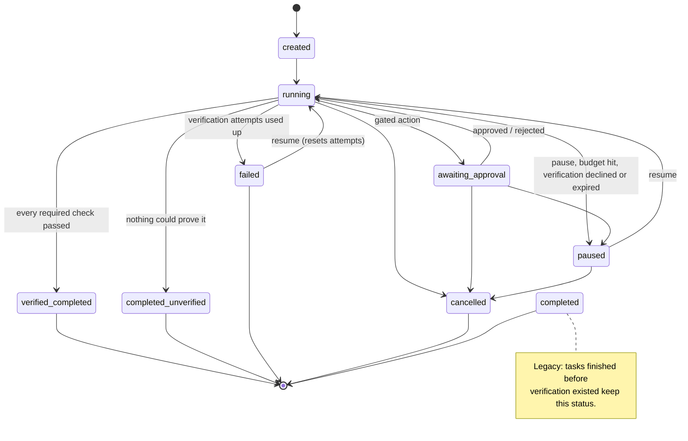

## Screenshots

All images are real captures of the current build (the app was running without the service, so it shows its labelled sample data).

| Home | Inbox |
| --- | --- |
| <picture><source media="(prefers-color-scheme: dark)" srcset="docs/assets/screenshots/app/appHome.dark.png">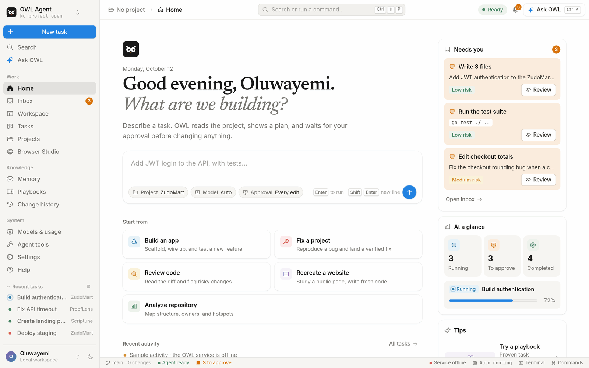</picture> | <picture><source media="(prefers-color-scheme: dark)" srcset="docs/assets/screenshots/app/inbox.dark.png">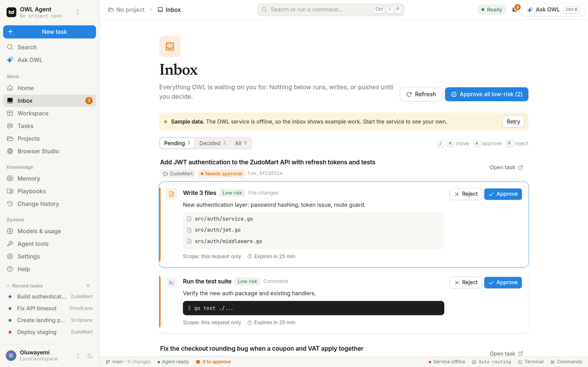</picture> |
| **Verification tab** | **Tasks board** |
| <picture><source media="(prefers-color-scheme: dark)" srcset="docs/assets/screenshots/workflow/taskVerification.dark.png">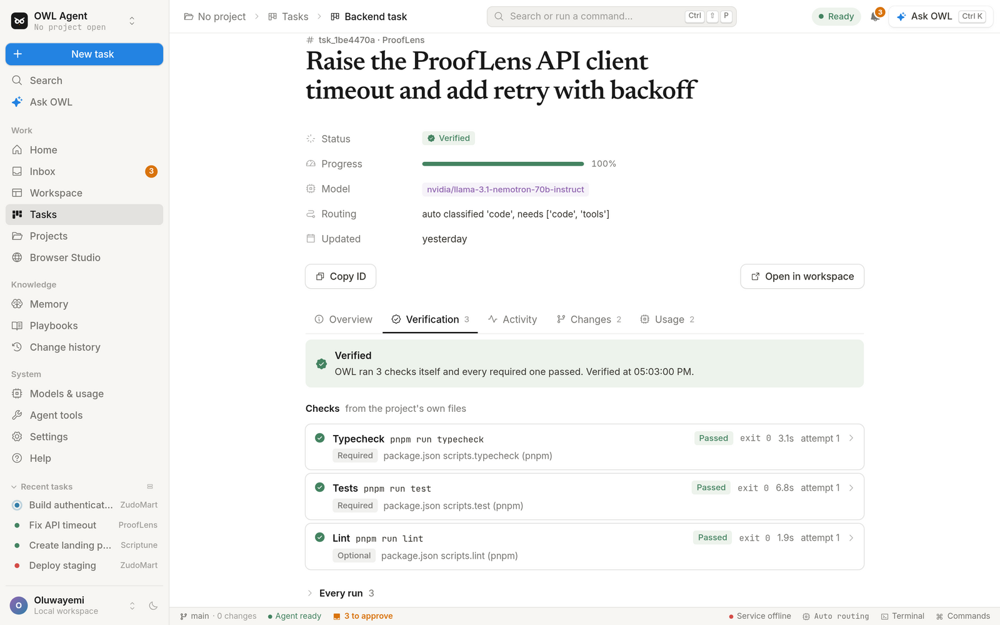</picture> | <picture><source media="(prefers-color-scheme: dark)" srcset="docs/assets/screenshots/views/tasksBoard.dark.png">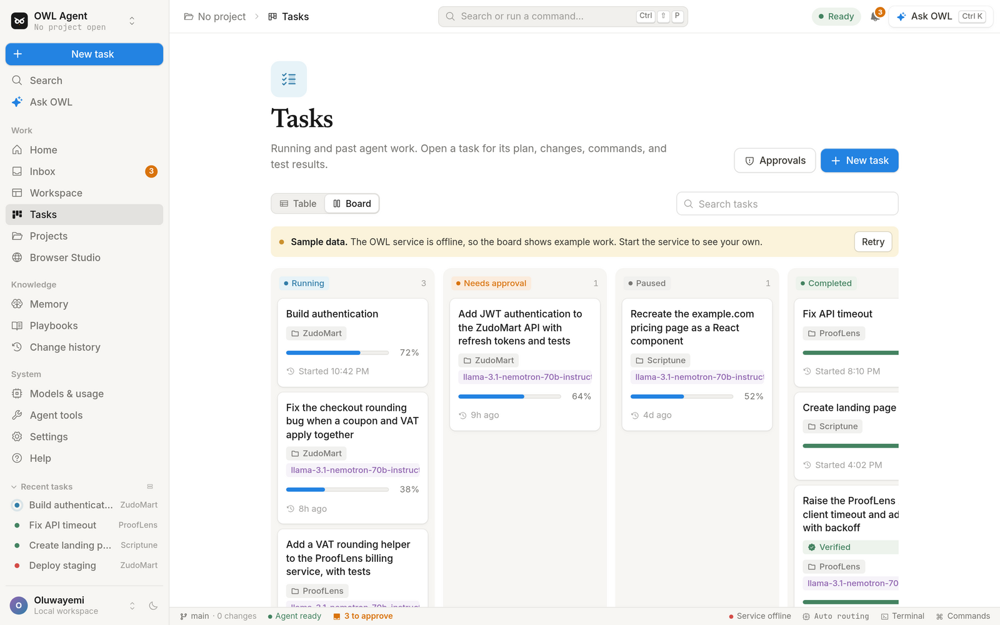</picture> |
| **Settings** | **Website** |
| <picture><source media="(prefers-color-scheme: dark)" srcset="docs/assets/screenshots/views/settings.dark.png">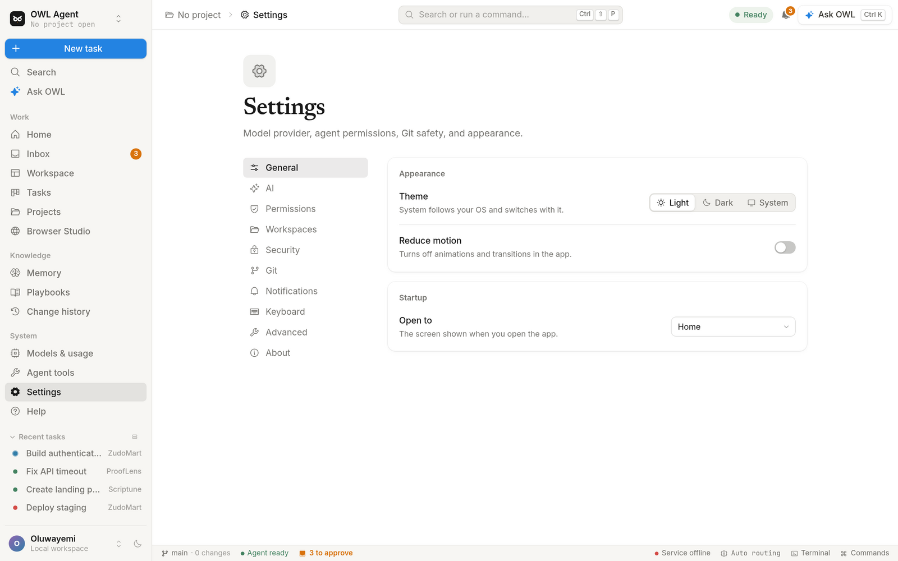</picture> | <picture><source media="(prefers-color-scheme: dark)" srcset="docs/assets/screenshots/website/websiteHero.dark.png">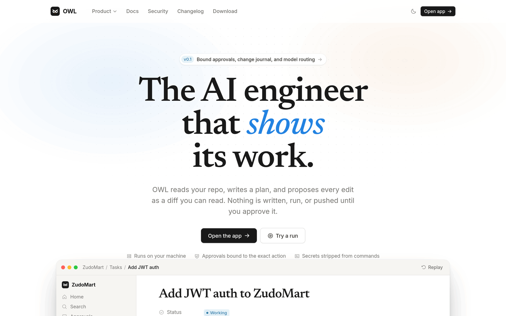</picture> |

## Installation

> [!WARNING]
> Installers are **not code-signed or notarized** yet. Windows SmartScreen and macOS Gatekeeper will warn you. Only bypass the warning for a file whose SHA-256 matches `SHA256SUMS.txt` from the same release. No release has been published yet; until one is, [build from source](#build-from-source).

Full details: [docs/INSTALL.md](docs/INSTALL.md).

**One-click download.** The website's **Download for Windows / macOS / Linux** button picks your system and starts the download straight away. The same files have stable links that always point at the newest published release:

| System | Website link | Direct link |
| --- | --- | --- |
| Windows x64 | `/download/windows` (`/download/windows-msi` for the MSI) | [OWL-Agent-Setup-x64.exe](https://github.com/oyinlola-tech/owl-agent/releases/latest/download/OWL-Agent-Setup-x64.exe) · [OWL-Agent-x64.msi](https://github.com/oyinlola-tech/owl-agent/releases/latest/download/OWL-Agent-x64.msi) |
| macOS Apple silicon | `/download/mac` | [OWL-Agent-macOS-AppleSilicon.dmg](https://github.com/oyinlola-tech/owl-agent/releases/latest/download/OWL-Agent-macOS-AppleSilicon.dmg) |
| macOS Intel | `/download/mac-intel` | [OWL-Agent-macOS-Intel.dmg](https://github.com/oyinlola-tech/owl-agent/releases/latest/download/OWL-Agent-macOS-Intel.dmg) |
| Linux x64 | `/download/linux` (`/download/linux-deb`, `/download/linux-rpm`) | [OWL-Agent-Linux-x64.AppImage](https://github.com/oyinlola-tech/owl-agent/releases/latest/download/OWL-Agent-Linux-x64.AppImage) · [.deb](https://github.com/oyinlola-tech/owl-agent/releases/latest/download/OWL-Agent-Linux-x64.deb) · [.rpm](https://github.com/oyinlola-tech/owl-agent/releases/latest/download/OWL-Agent-Linux-x64.rpm) |

These links only work once a release is published (GitHub ignores drafts and pre-releases for `/releases/latest`). The `/download` page also lists every versioned file and `SHA256SUMS.txt`, which covers both names.

<picture>
  <source media="(prefers-color-scheme: dark)" srcset="docs/assets/screenshots/website/downloadPage.dark.png">
  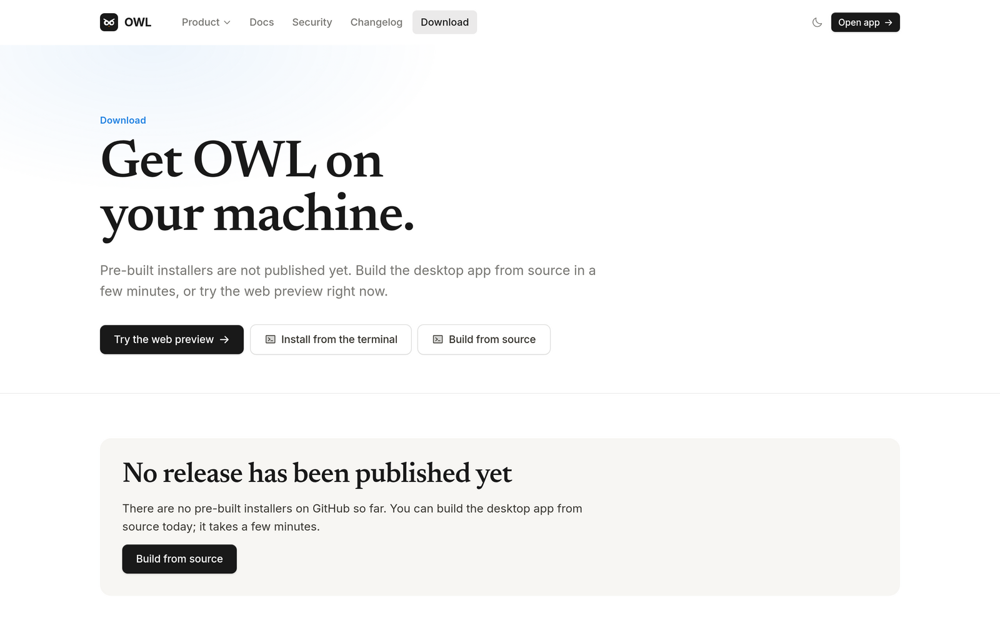
</picture>

**One-line installers.** They download the right file, check it against `SHA256SUMS.txt`, install it, and stop if the checksum is missing or wrong.

```sh
# macOS and Linux (AppImage by default; OWL_INSTALL_FORMAT=deb or rpm for packages)
curl -fsSL https://raw.githubusercontent.com/oyinlola-tech/owl-agent/main/scripts/install/owl.install.sh | sh
```

```powershell
# Windows (setup.exe by default; $env:OWL_INSTALL_FORMAT = "msi" for the MSI)
irm https://raw.githubusercontent.com/oyinlola-tech/owl-agent/main/scripts/install/owl.install.ps1 | iex
```

Options: `OWL_VERSION=v0.1.0`, `OWL_INSTALL_FORMAT`, `OWL_SKIP_CHECKSUM=1` (not recommended), and `--dry-run` / `$env:OWL_DRY_RUN = "1"`.

**GitHub CLI.**

```sh
gh release download --repo oyinlola-tech/owl-agent --pattern 'SHA256SUMS.txt' --pattern 'OWL-Agent-Linux-x64.AppImage'
sha256sum --check --ignore-missing SHA256SUMS.txt
```

**Manual.** Download the file for your system and `SHA256SUMS.txt` from [Releases](https://github.com/oyinlola-tech/owl-agent/releases), then verify:

| System | Files | Verify |
| --- | --- | --- |
| Windows x64 | `OWL.Agent_<version>_x64-setup.exe`, `OWL.Agent_<version>_x64_en-US.msi` | `(Get-FileHash .\<file> -Algorithm SHA256).Hash.ToLower()` |
| macOS (Apple silicon / Intel) | `OWL.Agent_<version>_aarch64.dmg`, `OWL.Agent_<version>_x64.dmg` | `shasum -a 256 --check --ignore-missing SHA256SUMS.txt` |
| Linux x64 | `.AppImage`, `.deb`, `.rpm` | `sha256sum --check --ignore-missing SHA256SUMS.txt` |

### Build from source

Requirements: Git, Node.js 22.12+ (CI uses 24), Python 3.11+ (CI uses 3.14), Rust stable, and the [Tauri system libraries](https://tauri.app/start/prerequisites/). On Ubuntu:

```sh
sudo apt install libwebkit2gtk-4.1-dev libappindicator3-dev librsvg2-dev patchelf
```

```sh
git clone https://github.com/oyinlola-tech/owl-agent.git
cd owl-agent

cd services/agent
python3 -m venv .venv
.venv/bin/pip install -e ".[dev]" "pyinstaller==6.16.0"
.venv/bin/python packaging/buildServiceBinary_packaging.py   # writes the Tauri sidecar binary
cd ../..

cd apps/desktop
npm ci
npx tauri build          # installers land in src-tauri/target/release/bundle/
```

## Usage

1. **First run.** Open OWL. The status bar shows whether the bundled service is online. To use a real model, put `NVIDIA_API_KEY` in a `.env` file in the app data folder (see [Configuration](#configuration)); without a provider, chat and tasks ask you to connect a model first.
2. **Open a project.** Use **Projects**, then **Open**. The agent can only touch folders listed in `OWL_WORKSPACES`; with no roots set it cannot read files, run commands, or use Git.
3. **Run a task.** Describe it on **Home** or in the workspace chat. OWL indexes the project, writes a plan, and shows live activity. Pause or stop at any time.
4. **Approve.** Gated actions appear in the workspace and in **Inbox** with their risk level, files, and exact command. Approve once or for the task, or reject.
5. **Review diffs.** The **Changes** tab shows each proposed file; accept or reject per file, undo the last decision, or revert applied changes later from **Change history**.
6. **Check verification.** Open a task from **Tasks**; the **Verification** tab lists each detected check, its source, exit code, duration, and the full output of every run.
7. **Memory.** The **Memory** page shows what OWL remembers by scope; edit, disable, or delete any entry.

`owl://app/<screen>` links open a screen directly, for example `owl://app/inbox`.

| Shortcut | Action |
| --- | --- |
| `Ctrl/Cmd + K` | Ask OWL from anywhere |
| `Ctrl/Cmd + Shift + P` | Command palette |
| `Ctrl/Cmd + J` | Show or hide the terminal |
| `Ctrl/Cmd + B` | Show or hide the file panel |
| `Ctrl/Cmd + Shift + E` | Review pending changes |
| `?` | Keyboard shortcuts |
| `Esc` | Close the palette or Ask OWL |

## Configuration

The service reads environment variables (`OWL_` prefix) or a `.env` file. For the installed app, place `.env` in the data folder: `%APPDATA%\com.oyinlola.owl-agent` (Windows), `~/Library/Application Support/com.oyinlola.owl-agent` (macOS), `~/.local/share/com.oyinlola.owl-agent` (Linux). Template: [services/agent/.env.example](services/agent/.env.example).

| Variable | Default | Purpose |
| --- | --- | --- |
| `NVIDIA_API_KEY` | empty | Enables the NVIDIA provider; never logged or returned. Empty means mock replies. |
| `NVIDIA_MODEL`, `NVIDIA_BASE_URL` | `nvidia/llama-3.1-nemotron-70b-instruct`, `https://integrate.api.nvidia.com/v1` | Default model and endpoint |
| `OWL_HOST`, `OWL_PORT` | `127.0.0.1`, `8000` | Bind address |
| `OWL_DB_PATH` | `owl.db` in the data folder (`~/.local/share/owl-agent/` when run from source) | SQLite file |
| `OWL_WORKSPACES` | empty | Comma-separated project roots the agent may touch (required for files, terminal, git) |
| `OWL_TRUSTED_ORIGINS` | empty | Extra CORS origins |
| `OWL_APPROVAL_TTL` | `1800` | Seconds before an unused approval lapses |
| `OWL_EXEC_TIMEOUT`, `OWL_EXEC_OUTPUT_LIMIT` | `120`, `65536` | Command timeout and captured output cap |
| `OWL_MAX_ITERATIONS`, `OWL_MAX_MODEL_CALLS`, `OWL_MAX_ELAPSED` | `25`, `40`, `1800` | Loop budgets; a task pauses when one is hit |
| `OWL_MAX_VERIFICATION_ATTEMPTS`, `OWL_VERIFY_TIMEOUT` | `3`, `600` | Verify-then-fix rounds; per-check timeout |
| `OWL_ROUTER_DEFAULT_MODEL`, `OWL_ROUTER_FALLBACK_MODEL`, `OWL_ROUTER_ALLOW_FALLBACK` | empty, empty, `true` | Routing policy |
| `OWL_CONTEXT_BUDGET`, `OWL_CONTEXT_RESERVE`, `OWL_MAX_RETRIES` | `0.8`, `0.25`, `2` | Context window use and provider retries |
| `OWL_MEMORY_RETENTION` | `200` | Memory history cap |
| `OWL_MAX_BODY_BYTES` | `262144` | Request body limit (HTTP 413 above it) |
| `OWL_SERVICE_TOKEN`, `OWL_SERVICE_TOKEN_FILE` | generated | Local service token (see [Security](#security)) |
| `OWL_REQUIRE_TOKEN`, `OWL_DEV_TOKEN`, `OWL_ALLOWED_HOSTS` | `false`, empty, empty | Token policy for development; extra allowed `Host` names |
| `OWL_SANDBOX`, `OWL_SANDBOX_BACKEND` | `preferred`, `auto` | `required` / `preferred` / `off`; `bubblewrap`, `sandbox-exec`, `docker`, `podman` |
| `OWL_SANDBOX_*` limits | 256 processes, 900 CPU s, 16384 MB, 4096 files | Resource limits inside the sandbox |
| `OWL_VERIFY_NETWORK` | `false` | Allow network access during verification runs |
| `OWL_BROWSER_ALLOW_LOOPBACK` | `false` | Let browser capture reach loopback addresses |

## Data model

Generated from [`databaseSchema_database.py`](services/agent/app/databases/databaseSchema_database.py) and the column additions in [`databaseConnection_database.py`](services/agent/app/databases/databaseConnection_database.py). `task_id` columns are logical links (SQLite foreign keys are not declared); `usage_records` and `compressions` may hold an empty `task_id` for chat traffic.

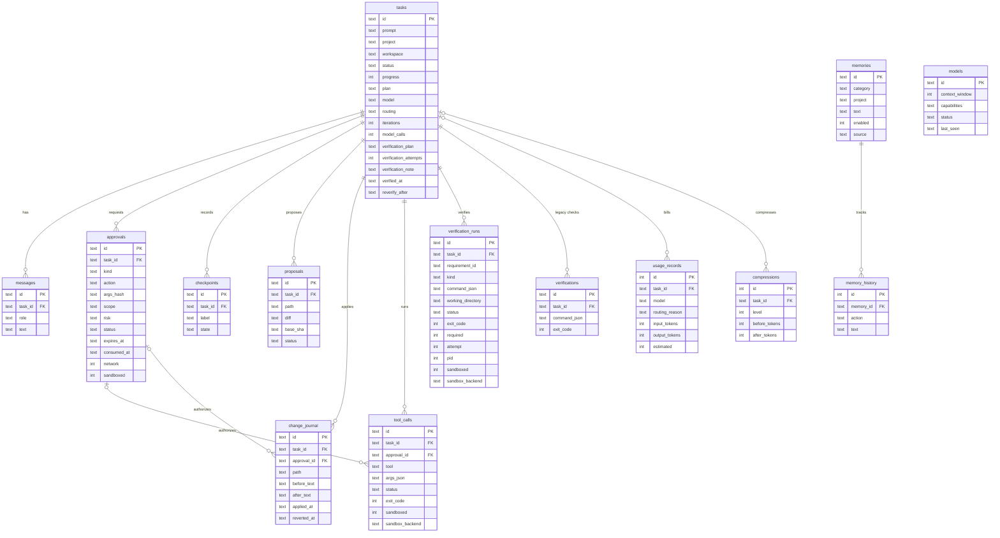

## Project structure

```text
apps/desktop/                     Desktop app and website (one Vite build)
├── src/
│   ├── appRoot.component.tsx     Chooses website or desktop app by path
│   ├── desktop/                  The app at /app
│   │   ├── components/           Small shared app widgets (toast, popover, stat card)
│   │   ├── dialogs/              Ask OWL, command palette, shortcuts, confirm, create project
│   │   ├── layout/               Sidebar, top bar, global shortcuts
│   │   ├── screens/              home, inbox, workspace, tasks, browser, knowledge, system
│   │   ├── services/             Agent API client, mock agent, sample data
│   │   ├── state/                Zustand stores and app state types
│   │   └── styles/               App styles
│   ├── shared/                   Helpers, hooks, platform detection, shared styles
│   └── website/                  Marketing site: home, docs, security, changelog, download
├── qa/                           Playwright UI QA suites (*.qa.ts)
└── src-tauri/                    Tauri 2 shell: sidecar process, owl:// deep links, bundling
services/agent/                   Python agent service
├── app/
│   ├── servers/                  create_app wiring and route registration
│   ├── routes/                   HTTP routes (tasks, providers, security, memory, ...)
│   ├── middlewares/              Body limit, request id, local service auth
│   ├── settings/                 Settings from the environment, service token
│   ├── tasks/                    TaskManager: states, agents, actions, verifications
│   ├── requirements/             Verification requirement model and toolchain detectors
│   ├── tools/                    Tool registry, argument models, handlers
│   ├── executors/                Commands, git, browser, file change journal
│   ├── sandboxes/                Sandbox policy, runner, self-test; bubblewrap, seatbelt, container
│   ├── guards/                   Workspace access, approval binding, command risk, scrubbing
│   ├── llms/                     Model registry, router, usage; NVIDIA and mock providers
│   ├── contexts/                 Context budget, compression, token counting
│   ├── memories/                 Memory store (SQLite)
│   ├── events/                   SSE event bus
│   ├── databases/                SQLite schema and connection
│   └── schemas/                  Pydantic shapes by domain
├── tests/                        pytest suites mirroring app/
├── scripts/                      e2e verification runs and repo checks
└── packaging/                    PyInstaller sidecar build
scripts/install/                  One-line installers (sh, PowerShell)
security/                         Scanner configs and an attack lab (Docker Compose)
docs/                             INSTALL.md and README assets
```

## Development

Backend (Python 3.11+):

```sh
cd services/agent
python3 -m venv .venv
.venv/bin/pip install -e ".[dev]"
cp .env.example .env
.venv/bin/python -m uvicorn --factory app:create_app --port 8000
```

Every request except `GET /health` needs the local service token. For a dev session, pick one value of 16+ characters and give it to both sides: start the service with `OWL_DEV_TOKEN=<value>` (or `OWL_SERVICE_TOKEN=<value>`) and the frontend with `VITE_OWL_DEV_TOKEN=<value>`. For direct API calls, send `Authorization: Bearer <value>`; the token the service is using is also written to `service.token` in its data folder.

```sh
curl http://127.0.0.1:8000/health                                              # open
curl -H "Authorization: Bearer $OWL_DEV_TOKEN" http://127.0.0.1:8000/security/status
```

Frontend (website at `http://localhost:1420/`, app at `/app`):

```sh
cd apps/desktop
npm install
npm run dev
```

If the service is unreachable or rejects the request, the UI falls back to clearly labelled sample data.

Checks (the same ones CI runs in `quality-checks.yml`):

```sh
# Backend
cd services/agent
.venv/bin/python -m pytest tests -q -p no:cacheprovider
.venv/bin/ruff check app tests scripts
.venv/bin/ruff format --check app tests scripts
.venv/bin/python scripts/e2e/verifyEndToEnd_e2e.py                          # real end-to-end verification run
.venv/bin/python scripts/checks/structureRule_check.py app tests scripts    # folder size and naming rules

# Frontend
cd apps/desktop
npm run typecheck
npm test            # vitest
npm run build
npm run qa          # Playwright UI QA (uses /usr/bin/chromium locally if present)
```

Codebase rules (in [docs/plans/codebase.plan.md](docs/plans/codebase.plan.md)): source files stay under about 350 lines, a folder holds at most five files (`__init__.py` excluded), and files are named `<whatItIs>` in camelCase plus the folder's role. See [services/agent/README.md](services/agent/README.md) for the full API and verification internals.

## Security

Report vulnerabilities as described in [SECURITY.md](SECURITY.md). What is in place today:

- **Server-side approvals.** Only a recorded decision unblocks a gated action, and only for the exact action hash, while fresh and unconsumed.
- **Workspace boundaries.** Paths are canonicalized against `OWL_WORKSPACES`; traversal and symlink escapes are rejected, and sensitive files need explicit opt-in.
- **Command safety.** Commands run as argv (no shell) with timeouts and capped output; `sudo`, `su`, `doas`, and `runas` are refused; recursive deletes, installs, and `curl` are flagged high risk. Environment variables named like KEY, TOKEN, SECRET, or PASSWORD are removed, and output is scrubbed of secrets.
- **Local service token.** Every request except `GET /health` needs a private per-install bearer token (from `OWL_SERVICE_TOKEN` or generated at startup, written `0600` to `service.token` in the data folder), compared in constant time. The `Host` header must be loopback (blocks DNS rebinding), and state-changing requests must be JSON.
- **Sandboxed execution.** Every command OWL runs (agent commands, verification runs, and git tools, which can run repository hooks) goes through one sandbox layer. On Linux that is bubblewrap: new namespaces, read-only system folders, the task workspace as the only writable bind, an empty `$HOME`, and `~/.ssh`, `~/.gnupg`, `~/.aws`, browser profiles, and the OWL data folder never bound. macOS `sandbox-exec` and Docker/Podman backends exist but are untested. Windows has no OS sandbox; commands fall back to unsandboxed with a visible warning on the approval and a `security.unsandboxed` event (`OWL_SANDBOX=required` refuses instead).
- **Network off by default.** A sandboxed command gets network only when the risk check says it needs it and its approval says "with network access". Verification runs never get network unless `OWL_VERIFY_NETWORK=1`.
- **Self-test and status.** At startup a probe inside the sandbox must fail to read outside the workspace and fail to reach a host socket; otherwise the backend counts as unavailable. `GET /security/status` reports the token, sandbox, and browser settings in effect.
- **Continuous scanning.** [`security-scans.yml`](.github/workflows/security-scans.yml) runs Bandit, Semgrep (with OWL rules), pip-audit, npm audit, cargo-audit, Gitleaks, and Trivy; configs live in [`security/scanners/`](security/scanners).

Model output, file contents, browser pages, and memories are treated as untrusted data and never override policy.

## Roadmap

- [x] Bound approvals, change journal with revert, checkpoints and resumable tasks
- [x] Independent verification (`verified_completed` / `completed_unverified`)
- [x] Installers for Windows, macOS, Linux and one-line installers
- [x] Security hardening: local service token, sandboxed command execution, network off by default, security scans in CI
- [ ] Code signing and notarization for installers
- [ ] More providers, API keys entered in the app, and local LLMs
- [ ] Local data controls and personalization
- [ ] Stack advisor for new projects

Detailed plans live in [docs/plans/](docs/plans): [providers and personalization](docs/plans/providers.plan.md), [security](docs/plans/security.plan.md), and [codebase rules](docs/plans/codebase.plan.md).

## Contributing

Contributions are welcome. Read [CONTRIBUTING.md](CONTRIBUTING.md) for setup, code rules, and the checks to run before opening a pull request.

## Author

Built by [Oluwayemi Oyinlola](https://portfolio.oyinlola.site/).

## License

Copyright (C) 2026 Oluwayemi Oyinlola

OWL is free software under the [GNU General Public License v3.0](LICENSE): you can redistribute it and/or modify it under the terms of that license. It is distributed in the hope that it will be useful, but without any warranty; see [LICENSE](LICENSE) for details.
